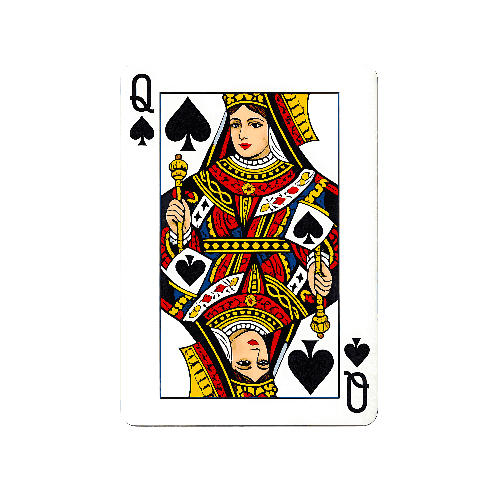

<div align="center">



# N-Queens Problem Visualisation

**An interactive, step-by-step visualiser for the N-Queens constraint-satisfaction problem — backtracking, branch & bound and bitwise solvers, with live telemetry.**

[](https://n-queens-problem-visualisation.onrender.com)
[](https://github.com/deepmaha2006/N-Queens-Problem-Visualisation)
[](LICENSE)


**[🔗 Live Demo](https://n-queens-problem-visualisation.onrender.com)** · **[📦 Source Code](https://github.com/deepmaha2006/N-Queens-Problem-Visualisation)** · **[🐞 Report an Issue](https://github.com/deepmaha2006/N-Queens-Problem-Visualisation/issues)**

</div>

---

## 📖 Table of Contents

- [Overview](#-overview)
- [Features](#-features)
- [Algorithms](#-algorithms)
- [Complexity Analysis](#-complexity-analysis)
- [Project Structure](#-project-structure)
- [Getting Started](#-getting-started)
- [Usage Guide](#-usage-guide)
- [Deployment](#-deployment)
- [Author](#-author)
- [License](#-license)

---

## 🎯 Overview

The **N-Queens Problem** asks how to place $N$ chess queens on an $N \times N$ board so that no two queens attack each other — no two share a row, column or diagonal.

This project turns that abstract search into something you can watch. Every queen placement, constraint check, conflict and backtrack is recorded as a step, which you can play, pause, rewind and inspect, while live metrics show how much of the search space the algorithm prunes.

---

## ✨ Features

| Feature | Description |
| :--- | :--- |
| ♛ **Step-by-step playback** | Play, pause, step forward/back, reset, and jump straight to the next solution. |
| ⚡ **Adjustable speed** | Visualisation interval from 800 ms down to 10 ms per step. |
| 📏 **Variable board size** | Choose $N$ from 4 to 12 with instant re-computation. |
| 🔴 **Attack rays** | Animated column and diagonal rays show each constraint check. |
| 🌡️ **Threat heatmap** | Shades every square by how many queens attack it. |
| 🧩 **Sandbox mode** | Place queens by hand, ask for a hint, then **Solve From Here**. |
| 📊 **Live telemetry** | Current step, recursive calls, backtracks, constraint checks, solutions found, % of search space pruned, and recursion depth. |
| 📝 **Activity log** | A live log of every milestone, colour-coded: safe placements and solutions in green, conflicts in red. Clears on each new run, or on demand. |
| 🏆 **Solutions gallery** | Mini-boards appear as each solution is discovered, labelled in algebraic notation (e.g. `A4 B2 C7 …`). Click one to load it. |
| 🎨 **Board themes** | Monochrome Minimal, Deep Obsidian, and Tournament Slate. |
| 🔊 **Audio feedback** | Procedurally synthesised sounds (Web Audio API) for placements, conflicts, backtracks and solutions. |

---

## 🧠 Algorithms

A queen at $(r_1, c_1)$ attacks a queen at $(r_2, c_2)$ when any of these hold:

- **Same column:** $c_1 = c_2$
- **Main diagonal:** $r_1 - c_1 = r_2 - c_2$
- **Anti-diagonal:** $r_1 + c_1 = r_2 + c_2$

(Rows never clash, because exactly one queen is placed per row.)

### 1. Classical Backtracking
A depth-first search over rows. For each candidate square, it scans earlier rows for column and diagonal attacks in $O(N)$. A conflict prunes the whole subtree; if no column in a row is safe, it backtracks to the previous row and tries the next column.

### 2. Branch & Bound (lookup arrays)
Keeps boolean arrays for occupied columns, main diagonals (index $r - c + N - 1$) and anti-diagonals (index $r + c$), so each safety check is $O(1)$.

### 3. Bitwise Benchmark
Represents columns and diagonals as bitmasks. Free positions are `~(cols | ld | rd) & mask`, the lowest free bit is extracted with `x & -x`, and diagonals shift with `(ld | bit) << 1` and `(rd | bit) >> 1`. This counts every solution in milliseconds and is shown as a benchmark rather than animated.

---

## 📈 Complexity Analysis

| Metric | Formula | Value for $N = 8$ |
| :--- | :--- | :--- |
| Naive search space | $N^N$ | 16,777,216 |
| Row-distinct permutations | $N!$ | 40,320 |
| Distinct valid solutions | — | **92** |
| Search space pruned | $\left(1 - \frac{\text{visited}}{N^N}\right) \times 100\%$ | **> 99.99%** |

Worst-case time for backtracking is $O(N!)$; space is $O(N)$ for the board and recursion stack.

---

## 🗂️ Project Structure

```
N-Queens-Problem-Visualisation/
├── index.html              # App layout: header, board, controls, telemetry, logs, gallery
├── css/
│   └── style.css           # Dark UI theme, board themes, log and gallery styling
├── images/
│   ├── logo.png            # Site logo
│   └── favicon.png         # Browser tab icon
└── js/
    ├── app.js              # Controller: events, playback, telemetry, logs, gallery
    ├── nqueensEngine.js    # Solvers that record the step-by-step search trace
    ├── boardRenderer.js    # Chessboard grid, attack rays, conflict markers, heatmap
    ├── queenPiece.js       # SVG queen piece generator
    └── audioManager.js     # Web Audio sound effects
```

Pure HTML, CSS and vanilla JavaScript (ES modules) — no frameworks, no build step, no dependencies.

---

## 🚀 Getting Started

### Prerequisites
- A modern browser (Chrome, Firefox, Edge or Safari)
- Python 3 or Node.js, only to run a local static server

### Run locally

```bash
# 1. Clone the repository
git clone https://github.com/deepmaha2006/N-Queens-Problem-Visualisation.git
cd N-Queens-Problem-Visualisation

# 2. Start a static server (either one)
python -m http.server 8080
# or
npx serve .

# 3. Open in your browser
#    http://localhost:8080
```

> **Note:** The app uses JavaScript ES modules, which browsers block on `file://` URLs. Serve it over HTTP rather than double-clicking `index.html`.

---

## 🎮 Usage Guide

| Control | Action |
| :--- | :--- |
| **N slider / 4 · 8 · 10** | Set the board size |
| **Algorithm** | Classical Backtracking, Branch & Bound, or Bitwise Benchmark |
| **First Solution Only** | Stop the search at the first solution found |
| **Play / Pause** | Start or stop the animation |
| **Step Next / Step Back** | Move one step forward or backward |
| **Reset** | Return to step 0 and start a fresh run |
| **Next Solution** | Jump to the next solution in the trace |
| **Speed** | Change the playback speed |
| **Attack Rays / Threat Heatmap** | Toggle the visual overlays |
| **Sandbox Mode** | Place queens manually; use **Hint**, **Clear Board** or **Solve From Here** |
| **Logs → Clear** | Empty the activity log |

---

## ☁️ Deployment

The site is hosted on **[Render](https://render.com)** as a static site and redeploys automatically on every push to `main`.

| Setting | Value |
| :--- | :--- |
| Service type | Static Site |
| Build command | *(none)* |
| Publish directory | `.` |

Live at: **https://n-queens-problem-visualisation.onrender.com**

---

## 👤 Author

**Deepesh Kumar Mahawar**

- GitHub: [@deepmaha2006](https://github.com/deepmaha2006)
- Email: [deepeshmahawar2006@gmail.com](mailto:deepeshmahawar2006@gmail.com)

If you find this project useful, please consider giving it a ⭐ on GitHub.

---

## 📜 License

Released under the [MIT License](LICENSE). © 2026 Deepesh Kumar Mahawar.
